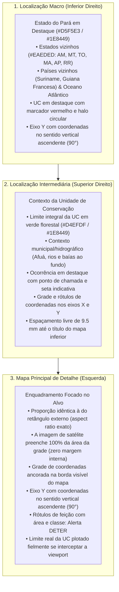

# QGIS Cartographic Layout Engine (Python / Google Colab)

Este módulo automatiza a produção de pranchas cartográficas institucionais no padrão do **Núcleo de Geotecnologias (NGEO/IDEFLOR-Bio)** sem depender da interface gráfica do QGIS, permitindo execução em scripts Python locais, pipelines de backend e notebooks do Google Colab.

O motor replica milimetricamente as posições, dimensões e proporções extraídas do arquivo `layout_elements.json` (gerado a partir de templates `.qpt` do QGIS).

---

## 1. Princípios e Hierarquia Cartográfica em 3 Níveis

O layout é construído em uma folha **A4 Paisagem ($297 \times 210\text{ mm}$)** e organiza a percepção espacial em três escalas articuladas:



---

## 2. Padrões de Diagramação e Convenções Cartográficas

1. **Alinhamento do Mapa Principal e Margens Homogêneas:**
   * A janela cartográfica principal possui a mesma proporção geométrica de sua moldura externa (`155.0 / 127.2 \approx 1{,}2185`).
   * A imagem de satélite cobre 100% do interior da grade, sem qualquer faixa de margem interna entre o raster e as linhas de coordenadas.
2. **Orientação dos Rótulos no Eixo Y (Vertical Ascendente):**
   * Em **todos os 3 mapas**, os textos de latitude no eixo Y estão posicionados com rotação de **90° (sentido vertical ascendente)**, acompanhando paralelamente a moldura e poupando espaço horizontal.
3. **Simplicidade dos Títulos nos Mapas de Apoio:**
   * Título simples direto: `LOCALIZAÇÃO DA OCORRÊNCIA NA UC` e `LOCALIZAÇÃO DA UNIDADE – PARQUE ESTADUAL CHARAPUCU` (sem subtítulos redundantes).
   * O mapa intermediário superior termina em $y = 90{,}0\text{ mm}$ com coordenadas terminando em $y = 94{,}0\text{ mm}$, garantindo um espaço livre de quase $10\text{ mm}$ até o título do mapa inferior ($y = 103{,}5\text{ mm}$).
4. **Centralização da Seta Norte e Barra de Escala:**
   * Ambos os elementos técnicos estão perfeitamente centralizados no eixo horizontal de simetria do bloco técnico ($x_{\text{center}} = 145{,}976\text{ mm}$).
5. **Legenda Completa das Camadas da Prancha:**
   * A legenda contempla as feições ativas em toda a composição:
     - Área de Corte Raso Auditada (DETER/INPE - 183,76 ha)
     - Limite do Parque Estadual Charapucu (72.506 ha)
     - Limite do Estado do Pará (Contexto Regional)
     - Corpos Hídricos & Várzea Estuarina (Baía Vieira Grande)
   * A imagem de satélite não é listada na legenda, sendo formalmente discriminada nas notas e fontes de dados do rodapé.

---

## 3. Elementos do Layout Cadastrados

| Item ID | Descrição | $x\text{ (mm)}$ | $y\text{ (mm)}$ | $w\text{ (mm)}$ | $h\text{ (mm)}$ | Tipo / Função |
| :--- | :--- | :---: | :---: | :---: | :---: | :--- |
| `txt_titulo` | Cabeçalho / Título Principal | 8.000 | 5.411 | 278.850 | 12.302 | Faixa com título oficial em caixa alta |
| `rec_mapa` | Moldura Externa do Mapa Principal | 8.150 | 14.108 | 167.106 | 137.143 | Retângulo de contenção |
| `mapa_geral` | Mapa Principal (Satélite + Vetor) | 14.150 | 18.000 | 155.000 | 127.200 | Viewport proporcional com grade ancorada |
| `rec_localizacao`| Painel Direito de Enquadramento | 175.254 | 14.108 | 111.466 | 184.402 | Painel para os dois mapas de apoio |
| `mapa_localizacao_imovel`| Inset Superior (Alvo na UC) | 180.000 | 22.500 | 102.000 | 67.500 | Contexto regional com coordenadas e Y a 90° |
| `mapa_localizacao_unidade`| Inset Inferior (UC no Pará) | 180.000 | 108.500 | 102.000 | 74.500 | Contexto macro estadual e países vizinhos |
| `rec_legenda` | Caixa de Legenda | 8.150 | 151.251 | 108.543 | 32.883 | Legenda completa de todas as feições |
| `rec_fonte` | Caixa de Metadados e Fontes | 8.150 | 184.135 | 108.543 | 14.375 | SIRGAS 2000, insumo EOX e notas |
| `rec_escala-icons-seta` | Caixa de Escala, Norte e Logos | 116.697 | 151.251 | 58.559 | 47.259 | Bloco técnico e institucional |
| `seta_norte` | Rosa dos Ventos / Norte | 140.476 | 153.200 | 11.000 | 13.000 | Vetor centralizado horizontalmente |
| `barra_escala` | Escala Gráfica e Numérica | 129.976 | 168.000 | 32.000 | 10.000 | Barra centralizada no mesmo eixo |
| `logo_ngeo` | Logotipo NGEO | 121.500 | 181.500 | 12.500 | 14.500 | Imagem institucional PNG |
| `logo_ideflorbio`| Logotipo IDEFLOR-Bio | 137.000 | 181.500 | 17.500 | 14.500 | Imagem institucional PNG |
| `logo_estado_para`| Brasão do Estado do Pará | 158.000 | 181.500 | 13.500 | 14.500 | Brasão oficial do Pará PNG |

---

## 4. Como Usar em Novos Projetos

```python
import geopandas as gpd
from qgis_layout_engine import QGISLayoutEngine

# 1. Carregar as geometrias do projeto
gdf_alvo = gpd.read_file("caminho/para/alvo.geojson")
gdf_uc = gpd.read_file("caminho/para/uc.geojson")
gdf_estados = gpd.read_file("caminho/para/estados_brasileiros.shp")
gdf_paises = gpd.read_file("caminho/para/america_do_sul.shp")

# 2. Inicializar o motor
engine = QGISLayoutEngine()
engine.create_layout()
engine.draw_frames()

# 3. Textos, logos e notas técnicas
engine.draw_header_and_titles(
    titulo_mapa="MAPA DE DIAGNÓSTICO – PARQUE ESTADUAL CHARAPUCU"
)
engine.draw_metadata_and_sources()
engine.draw_logos("caminho/logo_ngeo.png", "caminho/logo_ideflor.png", "caminho/brasao_para.png")
engine.draw_north_arrow()

# 4. Renderizar a hierarquia dos três mapas
engine.render_macro_map(gdf_estados, gdf_paises, gdf_uc)
engine.render_intermediate_map(gdf_uc, gdf_alvo)
engine.render_main_map(gdf_alvo, gdf_uc=gdf_uc, eox_year="2025")

# 5. Legenda e exportação
engine.render_legend()
engine.export("outputs/mapas/mapa_layout_qgis.png", "outputs/mapas/mapa_layout_qgis.pdf", dpi=300)
```
