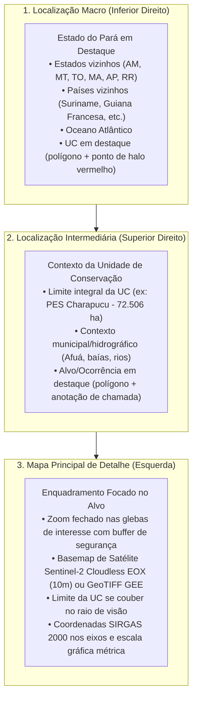

# QGIS Cartographic Layout Engine (Python / Google Colab)

Este módulo automatiza a produção de pranchas cartográficas institucionais no padrão do **Núcleo de Geotecnologias (NGEO/IDEFLOR-Bio)** sem depender da interface gráfica do QGIS, permitindo execução em scripts Python locais, pipelines de backend e notebooks do Google Colab.

O motor replica milimetricamente as posições, dimensões e proporções extraídas do arquivo `layout_elements.json` (gerado a partir de templates `.qpt` do QGIS).

---

## 1. Princípios e Hierarquia Cartográfica em 3 Níveis

O layout é construído em uma folha **A4 Paisagem ($297 \times 210\text{ mm}$)** e organiza a percepção espacial em três escalas articuladas:



### Regras Dinâmicas de Renderização
1. **Regra Polígono vs. Ponto no Mapa Macro:**  
   Como a maioria das Unidades de Conservação e glebas representa uma fração milimétrica na escala do Pará (~1:19.000.000), o motor plota a geometria vetorial preenchida **mais um marcador circular com halo semitransparente** e chamada de texto com fundo opaco.
2. **Regra de Zoom no Mapa Principal:**  
   O mapa principal calcula o bounding box do alvo, aplica um buffer ajustável (padrão 800 a 1.500 metros) e força a razão de aspecto exata da moldura ($160 \times 130\text{ mm} \approx 1{,}2307$), garantindo escala métrica equilibrada.

---

## 2. Sistema de Coordenadas da Prancha (QGIS mm $\rightarrow$ Matplotlib)

No QGIS, a origem das coordenadas $(0,0)$ situa-se no **canto superior esquerdo** da folha.  
No Matplotlib, a origem de `fig.add_axes([x, y, w, h])` situa-se no **canto inferior esquerdo** em coordenadas normalizadas $[0, 1]$.

A transformação matemática exata é:
$$\begin{aligned}
x_{\text{norm}} &= \frac{x_{\text{mm}}}{297.0} \\
y_{\text{norm}} &= \frac{210.0 - (y_{\text{mm}} + h_{\text{mm}})}{210.0} \\
w_{\text{norm}} &= \frac{w_{\text{mm}}}{297.0} \\
h_{\text{norm}} &= \frac{h_{\text{mm}}}{210.0}
\end{aligned}$$

---

## 3. Elementos do Layout Cadastrados

| Item ID | Descrição | $x\text{ (mm)}$ | $y\text{ (mm)}$ | $w\text{ (mm)}$ | $h\text{ (mm)}$ | Tipo / Função |
| :--- | :--- | :---: | :---: | :---: | :---: | :--- |
| `txt_titulo` | Cabeçalho / Título Principal | 8.000 | 5.411 | 278.850 | 12.302 | Faixa com título oficial em caixa alta |
| `rec_mapa` | Moldura do Mapa Geral | 8.150 | 14.108 | 167.106 | 137.143 | Retângulo de contenção do mapa principal |
| `mapa_geral` | Mapa Principal (Satélite + Vetor) | 11.762 | 17.680 | 160.000 | 130.000 | Janela cartográfica de detalhe |
| `rec_localizacao`| Painel Direito de Enquadramento | 175.254 | 14.108 | 111.466 | 184.402 | Painel com fundo neutro para insets |
| `mapa_localizacao_imovel`| Inset Superior (Alvo na UC) | 181.830 | 23.169 | 98.579 | 80.000 | Contexto regional intermediário |
| `mapa_localizacao_unidade`| Inset Inferior (UC no Pará) | 181.698 | 112.245 | 98.579 | 80.000 | Contexto macro estadual e países vizinhos |
| `rec_legenda` | Caixa de Legenda | 8.150 | 151.251 | 108.543 | 32.883 | Legenda convencionada das feições |
| `rec_escala-icons-seta` | Caixa de Escala, Norte e Logos | 116.697 | 151.251 | 58.559 | 47.259 | Painel técnico e institucional |
| `seta_norte` | Rosa dos Ventos / Norte | 141.844 | 153.554 | 11.162 | 13.435 | Vetor bipartite norte verdadeiro |
| `barra_escala` | Escala Gráfica e Numérica | 119.097 | 166.989 | 23.000 | 11.000 | Barra segmentada calibrada matematicamente |
| `rec_fonte` | Caixa de Metadados e Fontes | 8.150 | 184.135 | 108.543 | 14.375 | SIRGAS 2000, autoria e instituições |
| `logo_ngeo` | Logotipo NGEO | 122.760 | 181.528 | 13.238 | 15.279 | Imagem institucional PNG |
| `logo_ideflorbio`| Logotipo IDEFLOR-Bio | 137.500 | 181.528 | 17.806 | 15.000 | Imagem institucional PNG |
| `logo_estado_para`| Brasão do Estado do Pará | 157.066 | 181.072 | 15.024 | 15.087 | Brasão oficial do Pará PNG |

---

## 4. Integração de Imagens de Satélite EOX Sentinel-2 Cloudless

O motor consome o serviço WMTS/XYZ da EOX sem necessidade de chave de API ou cadastro:
```
https://tiles.maps.eox.at/wmts/1.0.0/s2cloudless-{ANO}_3857/default/GoogleMapsCompatible/{z}/{y}/{x}.jpg
```
* Anos suportados diretamente: `2025`, `2024`, `2023`, `2022`, `2021`, `2020`, `2019`, `2018`, `2017`.
* Como alternativa para recortes customizados de alta precisão (sem nuvens ou por sazonalidade), aceita GeoTIFFs exportados via Google Earth Engine pelo script do `ngeo_satellite_downloader.ipynb`.

---

## 5. Como Usar em Novos Projetos

```python
import geopandas as gpd
from qgis_layout_engine import QGISLayoutEngine

# 1. Carregar as geometrias do projeto
gdf_alvo = gpd.read_file("caminho/para/alvo.geojson")
gdf_uc = gpd.read_file("caminho/para/uc.geojson")
gdf_estados = gpd.read_file("caminho/para/estados_brasileiros.shp")
gdf_paises = gpd.read_file("caminho/para/america_do_sul.shp")

# 2. Inicializar o motor
engine = QGISLayoutEngine()
engine.create_layout()
engine.draw_frames()

# 3. Textos, logos e notas técnicas
engine.draw_header_and_titles(
    titulo_mapa="MAPA DE DIAGNÓSTICO – PARQUE ESTADUAL CHARAPUCU",
    subtitulo_unidade="PARQUE ESTADUAL CHARAPUCU"
)
engine.draw_metadata_and_sources()
engine.draw_logos("caminho/logo_ngeo.png", "caminho/logo_ideflor.png", "caminho/brasao_para.png")
engine.draw_north_arrow()

# 4. Renderizar a hierarquia dos três mapas
engine.render_macro_map(gdf_estados, gdf_paises, gdf_uc)
engine.render_intermediate_map(gdf_uc, gdf_alvo)
engine.render_main_map(gdf_alvo, gdf_uc=gdf_uc, eox_year="2025")

# 5. Legenda e exportação
engine.render_legend()
engine.export("outputs/mapa_a4.png", "outputs/mapa_a4.pdf", dpi=300)
```
