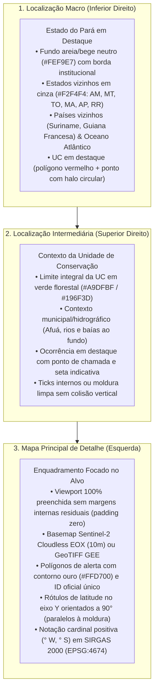

# QGIS Cartographic Layout Engine (Python / Google Colab)

Este módulo automatiza a produção de pranchas cartográficas institucionais no padrão do **Núcleo de Geotecnologias (NGEO/IDEFLOR-Bio)** sem depender da interface gráfica do QGIS, permitindo execução em scripts Python locais, pipelines de backend e notebooks do Google Colab.

O motor replica milimetricamente as posições, dimensões e proporções extraídas do arquivo `layout_elements.json` (gerado a partir de templates `.qpt` do QGIS) em estrita conformidade com as normas cartográficas nacionais.

---

## 1. Princípios e Hierarquia Cartográfica em 3 Níveis

O layout é construído em uma folha **A4 Paisagem ($297 \times 210\text{ mm}$)** e organiza a percepção espacial em três escalas articuladas:



---

## 2. Padrões Normativos de Conformidade Cartográfica

1. **Sistema de Coordenadas e Notação Cardinal:**
   * Utilizar estritamente `Sistema de Coordenadas: Geográficas | Datum: SIRGAS 2000 (EPSG:4674)`.
   * Notação cardinal positiva nos eixos: valores expressos como `50.395° W` e `0.395° S` (nunca negativos quando acompanhados da sigla cardinal).
   * Rotação de 90° no eixo Y: os valores de latitude acompanham verticalmente a moldura do mapa, sem colidir com margens externas.
2. **Preenchimento da Viewport (Zero Padding):**
   * A extensão espacial e a proporção da imagem raster ajustam-se com precisão milimétrica à razão `largura_mm / altura_mm` da janela cartográfica (`ax.set_aspect('auto')` com `ax.margins(0)`), evitando faixas brancas residuais.
3. **Fidelidade Vetorial de Unidades de Conservação:**
   * O perímetro de uma UC só deve ser desenhado no mapa de detalhe se o limite oficial físico interceptar comprovadamente a extensão geográfica delimitada pelo buffer do alvo. Caso o alvo seja interiorano à UC, a delimitação é demonstrada no mapa intermediário.
4. **Legenda Normativa:**
   * Título estrito: **`LEGENDA`**.
   * Discriminar exclusivamente classes temáticas vetorizadas ativas no corpo do mapa. Insumos sensores/matriciais pertencem às notas de rodapé (Fontes).
   * Não embutir cálculos quantitativos variáveis nos nomes das classes.
5. **Alinhamento e Diagramação Institucional:**
   * A seta norte e a escala gráfica métrica compartilham o mesmo eixo vertical de simetria (`x_center`).
   * Logotipos institucionais (NGEO, IDEFLOR-Bio e Governo do Pará) distribuem-se com espaçamento proporcional garantindo separação e ausência de sobreposição.

---

## 3. Elementos do Layout Cadastrados

| Item ID | Descrição | $x\text{ (mm)}$ | $y\text{ (mm)}$ | $w\text{ (mm)}$ | $h\text{ (mm)}$ | Tipo / Função |
| :--- | :--- | :---: | :---: | :---: | :---: | :--- |
| `txt_titulo` | Cabeçalho / Título Principal | 8.000 | 5.411 | 281.000 | 12.302 | Faixa com título oficial em caixa alta |
| `mapa_geral` | Mapa Principal (Satélite + Vetor) | 8.000 | 19.000 | 167.254 | 132.251 | Janela cartográfica de detalhe com moldura integrada |
| `rec_localizacao`| Painel Direito de Enquadramento | 175.254 | 19.000 | 113.746 | 179.500 | Painel com fundo neutro para insets |
| `mapa_localizacao_imovel`| Inset Superior (Alvo na UC) | 181.500 | 24.000 | 101.000 | 74.000 | Contexto regional intermediário |
| `mapa_localizacao_unidade`| Inset Inferior (UC no Pará) | 181.500 | 111.500 | 101.000 | 75.000 | Contexto macro estadual e países vizinhos |
| `rec_legenda` | Caixa de Legenda | 8.000 | 151.251 | 108.697 | 32.883 | Legenda normativa padronizada |
| `rec_escala-icons-seta` | Caixa de Escala, Norte e Logos | 116.697 | 151.251 | 58.557 | 47.259 | Painel técnico e institucional |
| `seta_norte` | Rosa dos Ventos / Norte | 140.476 | 153.200 | 11.000 | 12.000 | Vetor bipartite norte verdadeiro |
| `barra_escala` | Escala Gráfica e Numérica | 130.976 | 168.000 | 30.000 | 9.500 | Barra segmentada calibrada matematicamente |
| `rec_fonte` | Caixa de Metadados e Fontes | 8.000 | 184.135 | 108.697 | 14.375 | SIRGAS 2000, autoria e instituições |
| `logo_ngeo` | Logotipo NGEO | 118.500 | 181.500 | 12.500 | 13.500 | Imagem institucional PNG |
| `logo_ideflorbio`| Logotipo IDEFLOR-Bio | 135.500 | 181.500 | 17.500 | 13.500 | Imagem institucional PNG |
| `logo_estado_para`| Brasão do Estado do Pará | 157.500 | 181.500 | 13.000 | 13.500 | Brasão oficial do Pará PNG |

---

## 4. Como Usar em Novos Projetos

```python
import geopandas as gpd
from qgis_layout_engine import QGISLayoutEngine

# 1. Carregar as geometrias do projeto
gdf_alvo = gpd.read_file("caminho/para/alvo.geojson")
gdf_uc = gpd.read_file("caminho/para/uc.geojson")
gdf_estados = gpd.read_file("caminho/para/estados_brasileiros.shp")
gdf_paises = gpd.read_file("caminho/para/america_do_sul.shp")

# 2. Inicializar o motor
engine = QGISLayoutEngine()
engine.create_layout()
engine.draw_frames()

# 3. Textos, logos e notas técnicas
engine.draw_header_and_titles(
    titulo_mapa="MAPA DE DIAGNÓSTICO – PARQUE ESTADUAL CHARAPUCU",
    subtitulo_unidade="PARQUE ESTADUAL CHARAPUCU"
)
engine.draw_metadata_and_sources()
engine.draw_logos("caminho/logo_ngeo.png", "caminho/logo_ideflor.png", "caminho/brasao_para.png")
engine.draw_north_arrow()

# 4. Renderizar a hierarquia dos três mapas
engine.render_macro_map(gdf_estados, gdf_paises, gdf_uc)
engine.render_intermediate_map(gdf_uc, gdf_alvo)
engine.render_main_map(gdf_alvo, eox_year="2025", buffer_meters=1000)

# 5. Legenda e exportação
engine.render_legend()
engine.export("outputs/mapas/mapa_layout_qgis.png", "outputs/mapas/mapa_layout_qgis.pdf", dpi=300)
```
