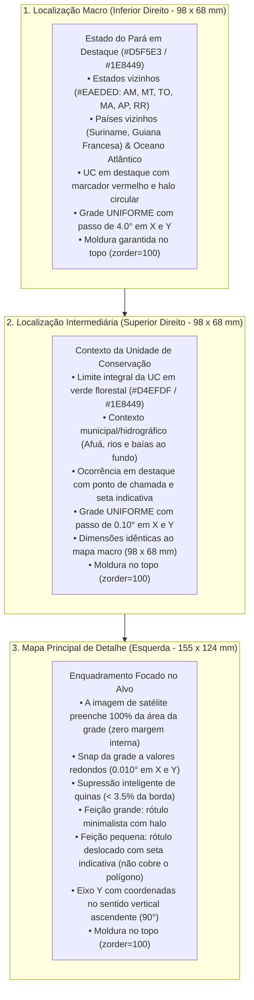

# QGIS Cartographic Layout Engine (Python / Google Colab)

Este módulo automatiza a produção de pranchas cartográficas institucionais no padrão do **Núcleo de Geotecnologias (NGEO/IDEFLOR-Bio)** sem depender da interface gráfica do QGIS, permitindo execução em scripts Python locais, pipelines de backend e notebooks do Google Colab.

O motor replica milimetricamente as posições, dimensões e proporções extraídas do arquivo `layout_elements.json` (gerado a partir de templates `.qpt` do QGIS).

---

## 1. Princípios e Hierarquia Cartográfica em 3 Níveis

O layout é construído em uma folha **A4 Paisagem ($297 \times 210\text{ mm}$)** e organiza a percepção espacial em três escalas articuladas:

---

## 2. Padrões de Diagramação e Convenções Cartográficas

1. **Tipografia Oficial nos Mapas (Segoe UI Semibold):**
   * Todos os textos do layout utilizam a família tipográfica **`Segoe UI Semibold`** (ou `Segoe UI` com peso `semibold`), proporcionando leitura moderna, nítida e corporativa em todas as escalas e coordenadas.
2. **Espaçamento e Desacoplamento do Título:**
   * A caixa do título principal ocupa o intervalo vertical de $y = 5{,}411\text{ mm}$ a $y = 17{,}713\text{ mm}$.
   * Todos os elementos e painéis inferiores iniciam em **$y = 18{,}5\text{ mm}$**, eliminando qualquer sobreposição ou colisão visual entre a faixa do cabeçalho e os retângulos inferiores.
3. **Supressão Inteligente de Rótulos de Canto (Corner Threshold):**
   * Coordenadas são suprimidas **apenas** quando a distância normalizada ao canto for inferior a $3{,}5\%$ ($u < 0{,}035$ ou $u > 0{,}965$), preservando todos os rótulos válidos que passem a distâncias seguras da quina.
4. **Grades Uniformes nos Mapas de Apoio:**
   * O espaçamento da grade nos mapas de apoio é estritamente simétrico nos eixos X e Y:
     - **Mapa Intermediário:** passo idêntico de $0{,}10^\circ$ em latitude e longitude.
     - **Mapa Macro:** passo idêntico de $4{,}0^\circ$ em latitude e longitude.
5. **Molduras Sempre por Cima das Camadas (Spines no Topo):**
   * Em todos os viewports de mapas, os eixos operam com `ax.set_axisbelow(False)` e todas as linhas perimetrais (`ax.spines`) recebem `zorder=100`, impedindo que mosaicos de satélite, camadas matriciais ou polígonos sobreponham ou apaguem as bordas da moldura.
6. **Orientação dos Rótulos no Eixo Y (Vertical Ascendente):**
   * Em todos os mapas, as coordenadas de latitude no eixo Y recebem rotação de **90°**, acompanhando paralelamente a margem externa.
7. **Rótulos Minimalistas com Tratamento Diferenciado de Escala:**
   * Feição grande ($> 20\text{ ha}$): rótulo centralizado com contorno/halo sutil.
   * Feição pequena ($< 20\text{ ha}$): rótulo deslocado externamente com linha/seta dourada apontando para o centroide, mantendo 100% da feição visível sobre a imagem orbital.
8. **Legenda com Camadas Vetoriais Efetivas:**
   * Reflete exclusivamente as feições vetoriais carregadas, sem classes hídricas fictícias e sem menção a hectares na linha da UC para evitar divergência formal com decretos.

---

## 3. Elementos do Layout Cadastrados

| Item ID | Descrição | $x\text{ (mm)}$ | $y\text{ (mm)}$ | $w\text{ (mm)}$ | $h\text{ (mm)}$ | Tipo / Função |
| :--- | :--- | :---: | :---: | :---: | :---: | :--- |
| `txt_titulo` | Cabeçalho / Título Principal | 8.000 | 5.411 | 278.850 | 12.302 | Faixa com título oficial em caixa alta |
| `rec_mapa` | Moldura Externa do Mapa Principal | 8.150 | 18.500 | 167.106 | 132.751 | Retângulo de contenção |
| `mapa_geral` | Mapa Principal (Satélite + Vetor) | 14.150 | 22.500 | 155.000 | 124.000 | Viewport proporcional com grade ancorada |
| `rec_localizacao`| Painel Direito de Enquadramento | 175.254 | 18.500 | 111.466 | 180.010 | Painel para os dois mapas de apoio |
| `mapa_localizacao_imovel`| Inset Superior (Alvo na UC) | 182.000 | 26.500 | 98.000 | 68.000 | Contexto regional com coordenadas (98 x 68 mm) |
| `mapa_localizacao_unidade`| Inset Inferior (UC no Pará) | 182.000 | 110.000 | 98.000 | 68.000 | Contexto macro estadual (98 x 68 mm) |
| `rec_legenda` | Caixa de Legenda | 8.150 | 151.251 | 108.543 | 32.883 | Legenda completa de todas as feições |
| `rec_fonte` | Caixa de Metadados e Fontes | 8.150 | 184.135 | 108.543 | 14.375 | SIRGAS 2000, insumo orbital e notas |
| `rec_escala-icons-seta` | Caixa de Escala, Norte e Logos | 116.697 | 151.251 | 58.559 | 47.259 | Bloco técnico e institucional |
| `seta_norte` | Rosa dos Ventos / Norte | 140.476 | 153.200 | 11.000 | 13.000 | Vetor centralizado horizontalmente |
| `barra_escala` | Escala Gráfica e Numérica | 129.976 | 168.000 | 32.000 | 10.000 | Barra centralizada no mesmo eixo |
| `logo_ngeo` | Logotipo NGEO | 121.500 | 181.500 | 12.500 | 14.500 | Imagem institucional PNG |
| `logo_ideflorbio`| Logotipo IDEFLOR-Bio | 137.000 | 181.500 | 17.500 | 14.500 | Imagem institucional PNG |
| `logo_estado_para`| Brasão do Estado do Pará | 158.000 | 181.500 | 13.500 | 14.500 | Brasão oficial do Pará PNG |
