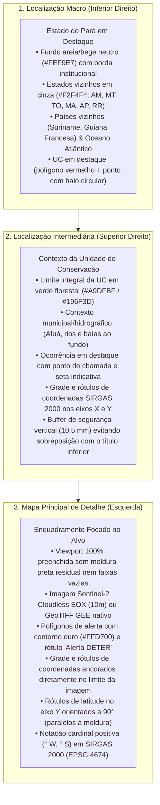

# QGIS Cartographic Layout Engine (Python / Google Colab)

Este módulo automatiza a produção de pranchas cartográficas institucionais no padrão do **Núcleo de Geotecnologias (NGEO/IDEFLOR-Bio)** sem depender da interface gráfica do QGIS, permitindo execução em scripts Python locais, pipelines de backend e notebooks do Google Colab.

O motor replica milimetricamente as posições, dimensões e proporções extraídas do arquivo `layout_elements.json` (gerado a partir de templates `.qpt` do QGIS) em estrita conformidade com as normas cartográficas nacionais e auditorias espaciais.

---

## 1. Princípios e Hierarquia Cartográfica em 3 Níveis

O layout é construído em uma folha **A4 Paisagem ($297 \times 210\text{ mm}$)** e organiza a percepção espacial em três escalas articuladas:



---

## 2. Padrões Normativos de Conformidade Cartográfica

1. **Preenchimento da Viewport (Zero Margem Interna / Zero Black Bands):**
   * A proporção de dados Web Mercator (`span_x / span_y`) é matematicamente igualada à proporção física exata da viewport (`map_w_mm / map_h_mm = 160.5 / 128.5 \approx 1{,}249`).
   * A moldura do mapa coincide rigorosamente com os limites visíveis da imagem raster; as marcas de ticks e coordenadas ancoram-se diretamente nessa borda.
2. **Sistema de Coordenadas e Notação Cardinal:**
   * Utilizar estritamente `Sistema de Coordenadas: Geográficas | Datum: SIRGAS 2000 (EPSG:4674)`.
   * Notação cardinal positiva nos eixos: valores expressos como `50.395° W` e `0.395° S` (nunca negativos quando acompanhados da sigla cardinal).
   * Rotação de 90° no eixo Y: os valores de latitude acompanham verticalmente a moldura do mapa, sem colidir com margens externas.
3. **Restauração e Espaçamento de Coordenadas nos Insets:**
   * O mapa intermediário mantém grade e coordenadas geográficas nos eixos X e Y.
   * O posicionamento vertical do título do mapa inferior ($y = 105{,}0\text{ mm}$) mantém um recuo seguro de mais de $10\text{ mm}$ em relação às coordenadas inferiores do mapa superior ($y = 94{,}5\text{ mm}$), garantindo legibilidade total e zero sobreposição.
4. **Rótulos Internos Padronizados:**
   * Supressão de identificadores internos técnicos de banco de dados (`ID: 52663_hist`). Uso exclusivo de denominação padronizada: `Alerta DETER`.
5. **Proporção Harmônica da Legenda e Metadados:**
   * Moldura da legenda redimensionada para $18{,}0\text{ mm}$ de altura, eliminando espaços vazios.
   * Compartimento de fontes expandido para $29{,}25\text{ mm}$ de altura com quebras de linha controladas, assegurando que o texto nunca ultrapasse a largura útil ($108{,}7\text{ mm}$) nem colida com os logotipos ou com a linha divisória inferior.
   * Centralização mútua e alinhamento coaxial da seta norte e da escala gráfica métrica ($x_{\text{center}} = 145{,}976\text{ mm}$).

---

## 3. Elementos do Layout Cadastrados

| Item ID | Descrição | $x\text{ (mm)}$ | $y\text{ (mm)}$ | $w\text{ (mm)}$ | $h\text{ (mm)}$ | Tipo / Função |
| :--- | :--- | :---: | :---: | :---: | :---: | :--- |
| `txt_titulo` | Cabeçalho / Título Principal | 8.000 | 5.411 | 281.000 | 12.302 | Faixa com título oficial em caixa alta |
| `mapa_geral` | Mapa Principal (Satélite + Vetor) | 11.500 | 18.500 | 160.500 | 128.500 | Viewport de detalhe com moldura integrada |
| `rec_localizacao`| Painel Direito de Enquadramento | 175.254 | 19.000 | 113.746 | 179.500 | Painel com fundo neutro para insets |
| `mapa_localizacao_imovel`| Inset Superior (Alvo na UC) | 183.000 | 25.000 | 98.000 | 66.000 | Contexto regional com coordenadas nos eixos |
| `mapa_localizacao_unidade`| Inset Inferior (UC no Pará) | 183.000 | 110.000 | 98.000 | 72.000 | Contexto macro estadual e países vizinhos |
| `rec_legenda` | Caixa de Legenda | 8.000 | 151.251 | 108.697 | 18.000 | Legenda compacta e proporcional |
| `rec_fonte` | Caixa de Metadados e Fontes | 8.000 | 169.251 | 108.697 | 29.259 | SIRGAS 2000, insumo óptico e notas |
| `rec_escala-icons-seta` | Caixa de Escala, Norte e Logos | 116.697 | 151.251 | 58.557 | 47.259 | Painel técnico e institucional |
| `seta_norte` | Rosa dos Ventos / Norte | 140.476 | 153.200 | 11.000 | 12.000 | Vetor bipartite norte verdadeiro |
| `barra_escala` | Escala Gráfica e Numérica | 130.976 | 168.000 | 30.000 | 9.500 | Barra segmentada calibrada matematicamente |
| `logo_ngeo` | Logotipo NGEO | 118.500 | 181.500 | 12.500 | 13.500 | Imagem institucional PNG |
| `logo_ideflorbio`| Logotipo IDEFLOR-Bio | 135.500 | 181.500 | 17.500 | 13.500 | Imagem institucional PNG |
| `logo_estado_para`| Brasão do Estado do Pará | 157.500 | 181.500 | 13.000 | 13.500 | Brasão oficial do Pará PNG |

---

## 4. Como Usar em Novos Projetos

```python
import geopandas as gpd
from qgis_layout_engine import QGISLayoutEngine

# 1. Carregar as geometrias do projeto
gdf_alvo = gpd.read_file("caminho/para/alvo.geojson")
gdf_uc = gpd.read_file("caminho/para/uc.geojson")
gdf_estados = gpd.read_file("caminho/para/estados_brasileiros.shp")
gdf_paises = gpd.read_file("caminho/para/america_do_sul.shp")

# 2. Inicializar o motor
engine = QGISLayoutEngine()
engine.create_layout()
engine.draw_frames()

# 3. Textos, logos e notas técnicas
engine.draw_header_and_titles(
    titulo_mapa="MAPA DE DIAGNÓSTICO – PARQUE ESTADUAL CHARAPUCU",
    subtitulo_unidade="PARQUE ESTADUAL CHARAPUCU"
)
engine.draw_metadata_and_sources()
engine.draw_logos("caminho/logo_ngeo.png", "caminho/logo_ideflor.png", "caminho/brasao_para.png")
engine.draw_north_arrow()

# 4. Renderizar a hierarquia dos três mapas
engine.render_macro_map(gdf_estados, gdf_paises, gdf_uc)
engine.render_intermediate_map(gdf_uc, gdf_alvo)
engine.render_main_map(gdf_alvo, eox_year="2025")

# 5. Legenda e exportação
engine.render_legend()
engine.export("outputs/mapas/mapa_layout_qgis.png", "outputs/mapas/mapa_layout_qgis.pdf", dpi=300)
```
