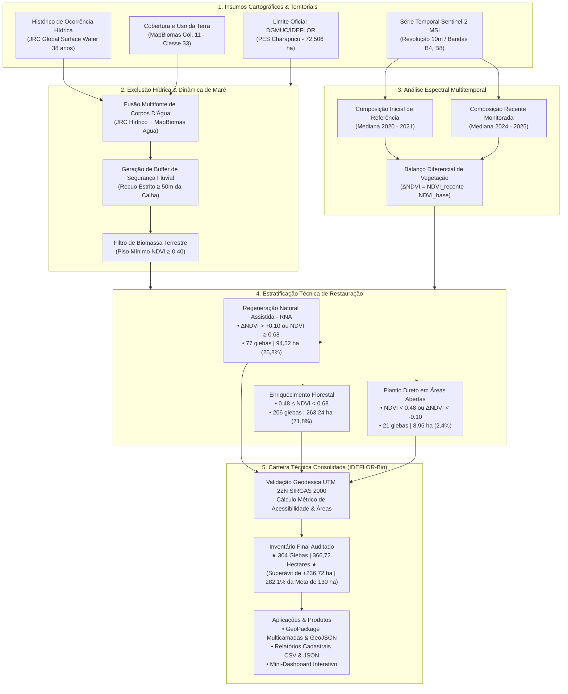

# Banco de Áreas Elegíveis para Restauração Florestal — Parque Estadual Charapucu

**Instituto de Desenvolvimento Florestal e da Biodiversidade do Estado do Pará (IDEFLOR-Bio)**  
**Diretoria de Gestão da Biodiversidade (DGBIO) / Núcleo de Geotecnologias (NGEO)**

[](https://colab.research.google.com/github/NGEO-IDEFLOR-Bio/restaura-pes-charapucu/blob/main/notebooks/dashboard_charapucu.ipynb)
-blue)
-darkgreen)


---

## 1. Identificação Institucional e Enquadramento

| Parâmetro Institucional | Especificação |
| :--- | :--- |
| **Órgão Gestor** | Instituto de Desenvolvimento Florestal e da Biodiversidade do Estado do Pará (IDEFLOR-Bio) |
| **Unidade Operacional** | Núcleo de Geotecnologias (NGEO) |
| **Unidade de Conservação (UC)** | Parque Estadual Charapucu (PES Charapucu) |
| **Ato Legal de Criação** | Decreto Estadual nº 2.592, de 09 de novembro de 2010 |
| **Categoria de Manejo** | Proteção Integral (SNUC / SEUC) |
| **Localização Administrativa** | Município de Afuá, Região de Integração do Marajó, Pará, Brasil |
| **Área do Decreto** | $65.181,94\text{ ha}$ |
| **Área Cartográfica Computada** | $72.506,22\text{ ha}$ ($725,06\text{ km}^2$) em projeção UTM |
| **Perímetro Oficial da UC** | $137,11\text{ km}$ (Circunscrito por canais e furos estuarinos navegáveis) |

---

## 2. Finalidade Estratégica do Projeto

O presente projeto tem por objetivo consolidar uma **carteira técnica auditada e georreferenciada de polígonos elegíveis para restauração florestal** no interior do Parque Estadual Charapucu.

A estratégia institucional adotada pelo IDEFLOR-Bio visa ultrapassar a meta básica contratual de **130 hectares**, construindo um inventário robusto com **superávit qualificado**. Esta carteira excedente fornece musculatura técnica ao órgão estadual para:
1. Submissão qualificada em editais públicos e chamadas de fomento à restauração ecológica (Fundo Amazônia, BNDES, GEF, recursos de compensação ambiental e conversão de multas).
2. Formulação de Termos de Cooperação Técnica e Parcerias Público-Privadas com metas escalonáveis.
3. Alocação prioritária de recursos com base em critérios objetivos de acessibilidade fluvial, redução de custos operacionais e aptidão ecológica de espécies de várzea.

---

## 3. Parâmetros Cartográficos e Geodésicos

Em estrita conformidade com os padrões do Sistema Cartográfico Nacional e diretrizes do IDEFLOR-Bio:

* **Sistema Geodésico de Referência:** SIRGAS 2000 (*Sistema de Referência Geocêntrico para as Américas*).
* **Projeção Cartográfica Oficial de Cálculo (Métrico):** `SIRGAS 2000 / UTM zone 22N` (`EPSG:31988`). Todas as métricas de área ($ha$), perímetro, raio de compacidade e distâncias euclidianas às vias navegáveis foram processadas exclusivamente sob este CRS.
* **Sistema de Coordenadas Geográficas (Armazenamento / Integração):** `SIRGAS 2000` (`EPSG:4674`).
* **Sistema de Referência para Web / Leaflet:** `WGS 84` (`EPSG:4326`), aplicado na interface do dashboard interativo e camadas GeoJSON.

---

## 4. Metodologia de Sensoriamento Remoto e Exclusão Hídrica

A identificação dos talhões no ecossistema de várzea estuarina do Rio Amazonas e Baía de Vieira Grande exigiu metodologia híbrida multitemporal:



### 4.1 Protocolo de Segurança Hídrica e Maré
Dada a alta turbidez e carga de sedimentos em suspensão dos rios marajoaras (que induzem falsos positivos em índices de água convencionais como o NDWI de McFeeters), aplicou-se:
1. **Exclusão de Água Multifonte:** Integração do histórico decadal do JRC Surface Water e da Classe 33 do MapBiomas.
2. **Piso Mínimo de Biomassa Terrestre ($\text{NDVI} \ge 0{,}40$):** Eliminação de praias de lama e bancos de sedimentos expostos em baixamar.
3. **Faixa de Recuo Fluvial ($\ge 50\text{ metros}$):** Amortecimento estrito a partir da calha fluvial, assegurando que nenhum talhão se sobreponha à rede hidrográfica ou à faixa de instabilidade de maré.

### 4.2 Dinâmica Espectral e Tipologia de Intervenção
* **Regeneração Natural Assistida (RNA):** Identificada onde há ganho consistente de biomassa ($\Delta\text{NDVI} > 0{,}10$ ou $\text{NDVI} \ge 0{,}68$). Consiste no coroamento, eliminação de cipós e condução de plântulas regenerantes de baixo custo.
* **Enriquecimento Florestal:** Vegetação com dossel ralo ou biomassa estagnada ($0{,}48 \le \text{NDVI} < 0{,}68$). Indica intervenção com adensamento de espécies nativas de várzea (*Euterpe oleracea* / açaizeiro nativo, *Virola surinamensis* / virola, *Carapa guianensis* / andiroba).
* **Plantio Direto:** Manchas severamente degradadas ($\text{NDVI} < 0{,}48$ ou $\Delta\text{NDVI} < -0{,}10$). Demanda plantio ativo integral e recomposição da estrutura vegetal.

---

## 5. Balanço Oficial da Carteira Auditada

* **Meta Contratual Básica:** $130{,}00\text{ ha}$
* **Área Total Terrestre Inventariada:** **$366{,}72\text{ ha}$**
* **Percentual da Meta Atingido:** **$282{,}1\%$**
* **Superávit Técnico Consolidado:** **$+236{,}72\text{ ha}$**
* **Número Total de Glebas Aptas:** **$304\text{ polígonos}$**
* **Distância Média aos Furos Navegáveis:** **$2.192{,}7\text{ metros}$**

### 5.1 Estratificação por Método de Intervenção
| Método de Restauração | Código | Qtd Glebas | Área Total ($ha$) | Participação | Distância Média aos Furos |
| :--- | :---: | :---: | :---: | :---: | :---: |
| **Enriquecimento Florestal** | `Enriquecimento` | 206 | $263{,}24\text{ ha}$ | $71{,}8\%$ | $2.187{,}7\text{ m}$ |
| **Regeneração Natural Assistida** | `RNA` | 77 | $94{,}52\text{ ha}$ | $25{,}8\%$ | $2.111{,}1\text{ m}$ |
| **Plantio Direto** | `Plantio Direto` | 21 | $8{,}96\text{ ha}$ | $2{,}4\%$ | $2.540{,}8\text{ m}$ |
| **TOTAL** | — | **304** | **$366{,}72\text{ ha}$** | **$100{,}0\%$** | **$2.192{,}7\text{ m}$** |

### 5.2 Estratificação por Acessibilidade Fluvial (Logística Operacional)
| Faixa de Acessibilidade | Distância à Calha Navegável | Qtd Glebas | Área Total ($ha$) | Participação | Viabilidade Logística |
| :--- | :---: | :---: | :---: | :---: | :--- |
| **Alta Acessibilidade** | $50\text{ a }200\text{ m}$ | 20 | $9{,}04\text{ ha}$ | $2{,}5\%$ | Desembarque direto por voadeiras com transporte manual de mudas |
| **Média Acessibilidade** | $200\text{ a }800\text{ m}$ | 53 | $49{,}04\text{ ha}$ | $13{,}4\%$ | Acesso por picadas curtas ou igarapés secundários |
| **Baixa Acessibilidade** | $> 800\text{ m}$ (Interior) | 231 | $308{,}64\text{ ha}$ | $84{,}1\%$ | Operações com acampamento base avançado no interior da ilha |

### 5.3 Estratificação por Classe de Porte
* **Pequeno Porte ($< 5\text{ ha}$):** 295 glebas ($243{,}80\text{ ha}$) — Adequado para projetos comunitários e manejo florestal em mosaico.
* **Médio Porte ($5 - 20\text{ ha}$):** 8 glebas ($77{,}20\text{ ha}$) — Blocos contínuos de intervenção otimizada.
* **Grande Porte ($20 - 50\text{ ha}$):** 1 gleba ($45{,}72\text{ ha}$) — Macro-intervenção prioritária com ganhos de escala.

---

## 6. Arquitetura do Repositório

```text
├── config.yml                            # Parâmetros cartográficos, limiares espectrais e caminhos
├── requirements.txt                      # Especificação técnica do ambiente Python
├── README.md                             # Documentação técnica oficial do projeto
├── Diretrizes do Projeto.md              # Diretrizes conceituais do NGEO/IDEFLOR-Bio
│
├── data/
│   ├── raw/                              # Insumos brutos (limite oficial DGMUC em EPSG:4674)
│   │   ├── ucs_estaduais.geojson
│   │   └── limite_pes_charapucu.geojson
│   └── processed/                        # Camadas reprojetadas e saneadas
│       ├── limite_pes_charapucu_utm22n.gpkg  (Camada oficial do PES em EPSG:31988)
│       ├── banco_restauracao_consolidado.geojson
│       └── talhoes_restauracao_charapucu.geojson
│
├── src/
│   ├── 00_extracao_limite_pes_charapucu.py  # Isolamento e validação topológica da UC
│   ├── 03_estratificacao_talhoes.py         # Métrica geodésica, setores e atributos
│   ├── 04_dashboard_components.py           # Construtores modulares de widgets, cards e mapa
│   ├── 05_saneamento_fluvial_local.py       # Exclusão hídrica com buffer de segurança (>= 50m)
│   └── gee/
│       ├── 01_levantamento_restauracao_charapucu.js # Script de produção para GEE Code Editor
│       └── 02_diagnostico_cobertura_charapucu.js   # Script de auditoria espectral e classes
│
├── notebooks/
│   └── dashboard_charapucu.ipynb            # Mini-Dashboard interativo para Google Colab
│
└── outputs/
    ├── vetores/
    │   ├── banco_restauracao_pes_charapucu.gpkg     # GeoPackage multicamada oficial
    │   │   ├── Layer 'carteira_completa_terrestre'   (304 glebas - 366,72 ha)
    │   │   ├── Layer 'prioridade_alta_acessibilidade' (Glebas <= 200m)
    │   │   └── Layer 'limite_pes_charapucu'          (Polígono DGMUC UTM 22N)
    │   └── banco_restauracao_pes_charapucu.geojson  (Camada padronizada para web EPSG:4326)
    │
    └── relatorios/
        ├── tabela_geral_todas_glebas.csv            (Atributos cadastrais das 304 glebas)
        ├── sintese_por_metodo.csv                   (Balanço por método de restauração)
        ├── sintese_por_acessibilidade.csv           (Balanço por distância aos furos)
        ├── sintese_por_porte.csv                    (Balanço por classe de tamanho)
        └── resumo_executivo_carteira.json           (Sumário estruturado para sistemas)
```

---

## 7. Dicionário de Dados da Base Vetorial

Os arquivos vetoriais ([banco_restauracao_pes_charapucu.gpkg](file:///H:/Meu%20Drive/IDEFLOR/levantamento-desmatamento-charapucu/outputs/vetores/banco_restauracao_pes_charapucu.gpkg) e [banco_restauracao_pes_charapucu.geojson](file:///H:/Meu%20Drive/IDEFLOR/levantamento-desmatamento-charapucu/outputs/vetores/banco_restauracao_pes_charapucu.geojson)) contêm a seguinte estrutura tabular:

| Campo | Tipo | Descrição Técnica | Exemplo |
| :--- | :--- | :--- | :--- |
| `id_gleba` | String | Identificador operacional único e sequencial da gleba | `GLEBA-001` |
| `metodo` | String | Tipologia de restauração florestal indicada | `Enriquecimento`, `RNA`, `Plantio Direto` |
| `area_ha` | Float | Área métrica calculada em projeção UTM Zone 22N ($ha$) | `45.72` |
| `classe_area` | String | Categoria de porte da gleba para planejamento de intervenção | `Grande (20 - 50 ha)` |
| `acesso_fluvial` | String | Faixa de acessibilidade logística com base na distância à margem | `Alta (50 - 200 m)` |
| `dist_margem_m` | Float | Distância euclidiana mínima calculada até a calha navegável ($m$) | `68.4` |
| `setor_fluvial` | String | Setor hidrográfico de referência circunscrito à ilha | `Furo do Charapucu / Norte` |
| `centroide_lat` | Float | Latitude do centroide em SIRGAS 2000 (graus decimais) | `-0.31254` |
| `centroide_lon` | Float | Longitude do centroide em SIRGAS 2000 (graus decimais) | `-50.48912` |
| `uc` | String | Nome da Unidade de Conservação estadual | `Parque Estadual Charapucu` |
| `municipio` | String | Município paraense sede da Unidade | `Afuá` |
| `geometry` | Geometry | Geometria vetorial bidimensional validada (`Polygon` / `MultiPolygon`) | — |

---

## 8. Execução do Mini-Dashboard no Google Colab

[](https://colab.research.google.com/github/NGEO-IDEFLOR-Bio/restaura-pes-charapucu/blob/main/notebooks/dashboard_charapucu.ipynb)

O notebook interativo [`notebooks/dashboard_charapucu.ipynb`](file:///H:/Meu%20Drive/IDEFLOR/levantamento-desmatamento-charapucu/notebooks/dashboard_charapucu.ipynb) pode ser executado instantaneamente na nuvem com **1 clique** no botão acima, ou localmente em ambiente Jupyter. Foi construído integralmente com bibliotecas open source (`ipywidgets`, `plotly`, `folium`, `geopandas`), dispensando servidores externos, bancos de dados dedicados ou licenças proprietárias. Ao ser aberto no Google Colab, o ambiente detecta automaticamente a plataforma e realiza o clone da base georreferenciada para visualização imediata.

### 8.1 Funcionalidades da Interface:
1. **Painel de Controles:**
   * Seleção múltipla de métodos (`RNA`, `Enriquecimento`, `Plantio Direto`).
   * Dropdowns de acessibilidade fluvial e classe de porte.
   * Slider dinâmico com limites mínimo e máximo de área ($ha$).
   * Botão de reset de filtros e botão de exportação da seleção corrente em `.gpkg` e `.csv`.
2. **Cards Dinâmicos de KPI:**
   * Atualização em tempo real da área selecionada e comparação percentual contra a meta base de 130 ha.
   * Contagem de polígonos selecionados e área média por talhão.
   * Distância média ponderada até a via navegável mais próxima.
   * Identificação do método de restauração predominante na seleção ativa.
3. **Painel Analítico Plotly:**
   * Gráfico donut com proporção percentual e volumetria por método.
   * Histograma de barras estruturado por classe de porte.
4. **Mapa Temático Reativo:**
   * Camada base de satélite de alta resolução (Esri World Imagery) e mapa de contexto claro (CartoDB Positron).
   * Contorno do limite oficial do PES Charapucu.
   * Polígonos coloridos por método com tooltips de sobrevoo e popups completos ao clique.
