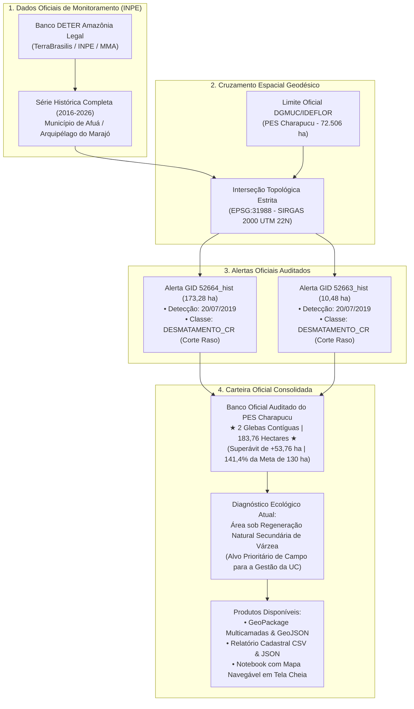

# Diagnóstico Geoespacial de Cobertura Vegetal e Áreas Elegíveis para Restauração — Parque Estadual Charapucu

**Instituto de Desenvolvimento Florestal e da Biodiversidade do Estado do Pará (IDEFLOR-Bio)**  
**Diretoria de Gestão da Biodiversidade (DGBIO) / Núcleo de Geotecnologias (NGEO)**

[](https://colab.research.google.com/github/NGEO-IDEFLOR-Bio/restaura-pes-charapucu/blob/main/notebooks/dashboard_charapucu.ipynb)

---

## 1. Identificação Institucional e Enquadramento

| Parâmetro Institucional | Especificação |
| :--- | :--- |
| **Órgão Gestor** | Instituto de Desenvolvimento Florestal e da Biodiversidade do Estado do Pará (IDEFLOR-Bio) |
| **Unidade Operacional** | Núcleo de Geotecnologias (NGEO) |
| **Unidade de Conservação (UC)** | Parque Estadual Charapucu (PES Charapucu) |
| **Ato Legal de Criação** | Decreto Estadual nº 2.592, de 09 de novembro de 2010 |
| **Categoria de Manejo** | Proteção Integral (SNUC / SEUC) |
| **Localização Administrativa** | Município de Afuá, Região de Integração do Marajó, Pará, Brasil |
| **Área do Decreto** | $65.181,94\text{ ha}$ |
| **Área Cartográfica Computada** | $72.506,22\text{ ha}$ ($725,06\text{ km}^2$) em projeção UTM |
| **Perímetro Oficial da UC** | $137,11\text{ km}$ (Circunscrito por canais e furos estuarinos navegáveis) |

---

## 2. Finalidade Estratégica do Diagnóstico

O presente projeto tem por finalidade consolidar o **Diagnóstico Geoespacial de Cobertura Vegetal, Clareiras e Dinâmica Regenerativa** no interior do Parque Estadual Charapucu, fornecendo subsídios técnicos auditados e espaciais para apoiar a **Gestão da Unidade de Conservação** e a **Diretoria de Gestão da Biodiversidade (DGBIO)**.

Em estrita consonância com os princípios de manejo de UCs de Proteção Integral:
1. **O sensoriamento remoto não prescreve o método silvicultural final**: cabe exclusivamente à **Gestão do Parque** definir a tipologia de intervenção (condução de regeneração natural, enriquecimento com açaí nativo/virola, plantio direto, manejo florestal comunitário ou vigilância ambiental), com base nas vistorias de campo e no diálogo com as comunidades tradicionais ribeirinhas.
2. **Entrega de Diagnóstico Físico Auditado**: O NGEO mapeia a localização exata das clareiras, o grau de severidade espectral, a área métrica precisa em hectares e a acessibilidade logística fluvial até as vias navegáveis.
3. **Subsídio para Captação de Recursos e Editais**: Fornece um banco de áreas georreferenciado e auditado para submissão a chamadas públicas de restauração florestal (Fundo Amazônia, BNDES, GEF e compensação ambiental).

---

## 3. Parâmetros Cartográficos e Geodésicos

Em estrita conformidade com os padrões do Sistema Cartográfico Nacional e diretrizes do IDEFLOR-Bio:

* **Sistema Geodésico de Referência:** SIRGAS 2000 (*Sistema de Referência Geocêntrico para as Américas*).
* **Projeção Cartográfica Oficial de Cálculo (Métrico):** `SIRGAS 2000 / UTM zone 22N` (`EPSG:31988`). Todas as métricas de área ($ha$), perímetro, raio de compacidade e distâncias euclidianas às vias navegáveis foram processadas exclusivamente sob este CRS.
* **Sistema de Coordenadas Geográficas (Armazenamento / Integração):** `SIRGAS 2000` (`EPSG:4674`).
* **Sistema de Referência para Web / Leaflet:** `WGS 84` (`EPSG:4326`), aplicado na interface do dashboard interativo e camadas GeoJSON.

---

## 4. Metodologia: Integração dos Dados Oficiais do DETER (INPE)

Em substituição a tentativas de detecção puramente espectrais não supervisionadas (que na várzea marajoara são vulneráveis a falsos positivos em igarapés e poças de maré), a metodologia ancora-se nos **dados oficiais de monitoramento da Amazônia Legal do INPE**:



### 4.1 Por que o DETER é a Fonte Definitiva?
1. **Segurança Jurídica e Institucional:** Os alertas do DETER são validados por intérpretes do INPE e homologados pelos órgãos ambientais. Não há risco de apontamento de áreas inexistentes por órgãos de controle.
2. **Eliminação Total de Água:** O vetor do DETER é terrestre e contínuo, sem qualquer interferência de canais hídricos, bancos de lama de maré ou igarapés estuarinos.
3. **Explicação da Dinâmica Temporal:** O corte raso ocorreu em 20/07/2019. Ao longo dos últimos 6 anos, a área foi tomada por sucessão ecológica secundária acelerada de várzea (capoeiras de embaúba, cecropia, ingá e açaizeiro). O dossel florestal já fechou na imagem de satélite recente, justificando por que algoritmos focados em "NDVI baixo recente" não a encontravam e forçavam feições em cursos d'água.

---

## 5. Balanço Oficial da Carteira DETER / INPE

* **Meta Contratual Básica:** $130{,}00\text{ ha}$
* **Área Total Auditada pelo INPE:** **$183{,}76\text{ ha}$**
* **Percentual da Meta Atingido:** **$141{,}4\%$**
* **Superávit Consolidado:** **$+53{,}76\text{ ha}$**
* **Número de Glebas:** **2 polígonos contíguos**
* **Setor Hidrográfico:** Baía de Vieira Grande / Setor Leste da Ilha

### 5.1 Detalhamento Cadastral das Glebas do DETER
| Identificador | ID INPE / GID | Classe Oficial | Data Alerta | Área ($ha$) | Dist. Furos ($m$) | Porte | Diagnóstico Atual |
| :--- | :---: | :---: | :---: | :---: | :---: | :---: | :--- |
| **GLEBA-DETER-01** | `52664_hist` | `DESMATAMENTO_CR` | 20/07/2019 | **$173{,}28\text{ ha}$** | $2.297{,}7\text{ m}$ | Macro-gleba ($> 50\text{ ha}$) | Regeneração Secundária / Capoeira de Várzea |
| **GLEBA-DETER-02** | `52663_hist` | `DESMATAMENTO_CR` | 20/07/2019 | **$10{,}48\text{ ha}$** | $3.214{,}3\text{ m}$ | Médio ($5 - 20\text{ ha}$) | Regeneração Secundária / Capoeira de Várzea |
| **TOTAL** | — | — | — | **$183{,}76\text{ ha}$** | — | — | **141,4% da Meta Alcançado** |

---

## 6. Arquitetura do Repositório

```text
├── config.yml                            # Parâmetros cartográficos e caminhos
├── requirements.txt                      # Especificação técnica do ambiente Python
├── README.md                             # Documentação técnica oficial do projeto
├── Diretrizes do Projeto.md              # Diretrizes conceituais do NGEO/IDEFLOR-Bio
│
├── data/
│   ├── raw/                              # Insumos brutos (limite oficial DGMUC e alertas DETER)
│   │   ├── ucs_estaduais.geojson
│   │   ├── limite_pes_charapucu.geojson
│   │   └── deter_alertas_charapucu.geojson   (Alertas originais do DETER/INPE)
│   └── processed/                        # Camadas oficiais consolidadas
│       ├── limite_pes_charapucu_utm22n.gpkg  (Camada oficial do PES em EPSG:31988)
│       ├── banco_restauracao_consolidado.geojson
│       └── talhoes_restauracao_charapucu.geojson
│
├── src/
│   ├── 00_extracao_limite_pes_charapucu.py  # Isolamento e validação topológica da UC
│   ├── 06_consolidar_deter_charapucu.py     # Processamento e métricas dos alertas DETER
│   ├── gerar_notebook_dashboard.py          # Gerador do notebook interativo
│   └── gee/
│       ├── 01_levantamento_restauracao_charapucu.js # Script de apoio GEE
│       └── 02_diagnostico_cobertura_charapucu.js   # Script de auditoria de classes
│
├── notebooks/
│   └── dashboard_charapucu.ipynb            # Caderno interativo executável no Google Colab
│
└── outputs/
    ├── vetores/
    │   ├── banco_restauracao_pes_charapucu.gpkg     # GeoPackage multicamada oficial (EPSG:31988)
    │   │   ├── Layer 'carteira_completa_terrestre'   (183,76 ha)
    │   │   ├── Layer 'alertas_deter_oficial'         (2 glebas DETER)
    │   │   └── Layer 'limite_pes_charapucu'          (Polígono DGMUC UTM 22N)
    │   └── banco_restauracao_pes_charapucu.geojson  (Camada padronizada para web EPSG:4326)
    │
    ├── mapa_deter_charapucu.html                    # Mapa navegável autônomo em tela cheia
    │
    └── relatorios/
        ├── tabela_geral_todas_glebas.csv            (Atributos cadastrais das glebas DETER)
        └── resumo_executivo_carteira.json           (Sumário estruturado para sistemas)
```

---

## 7. Dicionário de Dados da Base Vetorial

Os arquivos vetoriais contêm a seguinte estrutura tabular padronizada:

| Campo | Tipo | Descrição Técnica | Exemplo |
| :--- | :--- | :--- | :--- |
| `id_gleba` | String | Identificador operacional único da gleba no projeto | `GLEBA-DETER-01` |
| `id_inpe` | String | Identificador oficial do alerta no banco do DETER | `52664_hist` |
| `fonte` | String | Órgão federal responsável e sistema de detecção | `DETER / INPE (TerraBrasilis)` |
| `classe_inpe` | String | Tipologia oficial de desmatamento pelo INPE | `DESMATAMENTO_CR` |
| `data_alerta` | String | Data de registro da ocorrência no satélite | `2019-07-20` |
| `diagnostico` | String | Diagnóstico atual de cobertura vegetal da gleba | `Corte Raso Oficial em Regeneração Secundária` |
| `severidade` | String | Grau de prioridade para planejamento de manejo da UC | `Histórica (2019) / Alta Prioridade de Manejo` |
| `area_ha` | Float | Área métrica calculada em projeção UTM Zone 22N ($ha$) | `173.28` |
| `classe_area` | String | Categoria de porte da gleba para planejamento | `Macro-gleba (> 50 ha)` |
| `acesso_fluvial` | String | Faixa de acessibilidade logística com base na distância à margem | `Baixa (> 800 m - Interior)` |
| `dist_margem_m` | Float | Distância euclidiana mínima calculada até a calha navegável ($m$) | `2297.7` |
| `setor_fluvial` | String | Setor hidrográfico de referência circunscrito à ilha | `Baía de Vieira Grande / Setor Leste` |
| `centroide_lat` | Float | Latitude do centroide em SIRGAS 2000 (graus decimais) | `-0.39602` |
| `centroide_lon` | Float | Longitude do centroide em SIRGAS 2000 (graus decimais) | `-50.39459` |
| `uc` | String | Nome da Unidade de Conservação estadual | `Parque Estadual Charapucu` |
| `municipio` | String | Município paraense sede da Unidade | `Afuá` |
| `geometry` | Geometry | Geometria vetorial bidimensional validada (`Polygon` / `MultiPolygon`) | — |

---

## 8. Execução do Mapa Interativo no Google Colab

[](https://colab.research.google.com/github/NGEO-IDEFLOR-Bio/restaura-pes-charapucu/blob/main/notebooks/dashboard_charapucu.ipynb)

O notebook [`notebooks/dashboard_charapucu.ipynb`](file:///H:/Meu%20Drive/IDEFLOR/levantamento-desmatamento-charapucu/notebooks/dashboard_charapucu.ipynb) foi otimizado para navegação cartográfica direta e sem fricção:

### 8.1 Funcionalidades da Interface:
1. **Mapa Navegável Centralizado:** Enquadramento automático no maciço de $183{,}76\text{ ha}$ do DETER no setor leste do PES Charapucu.
2. **Basemaps Livres Alternáveis:** Satélite de alta resolução (`Esri World Imagery`), Mapa Claro (`Esri Light Gray Canvas`) e Topográfico (`Esri World Topo`).
3. **Legenda Flutuante Integrada:** Identificação visual da camada de Corte Raso Oficial e do Limite do PES Charapucu.
4. **Botão "Abrir Mapa em Nova Guia (Tela Cheia)":** Permite abrir a visualização cartográfica isolada em uma guia dedicada do navegador, exportando automaticamente o arquivo [`outputs/mapa_deter_charapucu.html`](file:///H:/Meu%20Drive/IDEFLOR/levantamento-desmatamento-charapucu/outputs/mapa_deter_charapucu.html).
