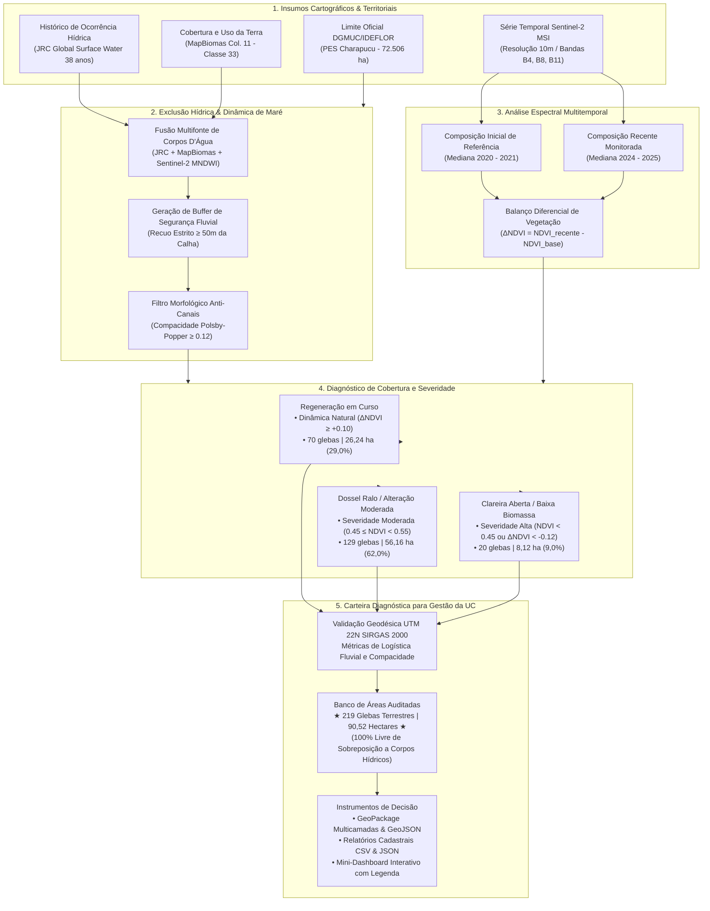

# Diagnóstico Geoespacial de Cobertura Vegetal e Áreas Elegíveis para Restauração — Parque Estadual Charapucu

**Instituto de Desenvolvimento Florestal e da Biodiversidade do Estado do Pará (IDEFLOR-Bio)**  
**Diretoria de Gestão da Biodiversidade (DGBIO) / Núcleo de Geotecnologias (NGEO)**

[](https://colab.research.google.com/github/NGEO-IDEFLOR-Bio/restaura-pes-charapucu/blob/main/notebooks/dashboard_charapucu.ipynb)

---

## 1. Identificação Institucional e Enquadramento

| Parâmetro Institucional | Especificação |
| :--- | :--- |
| **Órgão Gestor** | Instituto de Desenvolvimento Florestal e da Biodiversidade do Estado do Pará (IDEFLOR-Bio) |
| **Unidade Operacional** | Núcleo de Geotecnologias (NGEO) |
| **Unidade de Conservação (UC)** | Parque Estadual Charapucu (PES Charapucu) |
| **Ato Legal de Criação** | Decreto Estadual nº 2.592, de 09 de novembro de 2010 |
| **Categoria de Manejo** | Proteção Integral (SNUC / SEUC) |
| **Localização Administrativa** | Município de Afuá, Região de Integração do Marajó, Pará, Brasil |
| **Área do Decreto** | $65.181,94\text{ ha}$ |
| **Área Cartográfica Computada** | $72.506,22\text{ ha}$ ($725,06\text{ km}^2$) em projeção UTM |
| **Perímetro Oficial da UC** | $137,11\text{ km}$ (Circunscrito por canais e furos estuarinos navegáveis) |

---

## 2. Finalidade Estratégica do Diagnóstico

O presente projeto tem por finalidade consolidar o **Diagnóstico Geoespacial de Cobertura Vegetal, Clareiras e Dinâmica Regenerativa** no interior do Parque Estadual Charapucu, fornecendo subsídios técnicos auditados e espaciais para apoiar a **Gestão da Unidade de Conservação** e a **Diretoria de Gestão da Biodiversidade (DGBIO)**.

Em estrita consonância com os princípios de manejo de UCs de Proteção Integral:
1. **O sensoriamento remoto não prescreve o método silvicultural final**: cabe exclusivamente à **Gestão do Parque** definir a tipologia de intervenção (condução de regeneração natural, enriquecimento com açaí nativo/virola, plantio direto, manejo florestal comunitário ou vigilância ambiental), com base nas vistorias de campo e no diálogo com as comunidades tradicionais ribeirinhas.
2. **Entrega de Diagnóstico Físico Auditado**: O NGEO mapeia a localização exata das clareiras, o grau de severidade espectral, a área métrica precisa em hectares e a acessibilidade logística fluvial até as vias navegáveis.
3. **Subsídio para Captação de Recursos e Editais**: Fornece um banco de áreas georreferenciado e auditado para submissão a chamadas públicas de restauração florestal (Fundo Amazônia, BNDES, GEF e compensação ambiental).

---

## 3. Parâmetros Cartográficos e Geodésicos

Em estrita conformidade com os padrões do Sistema Cartográfico Nacional e diretrizes do IDEFLOR-Bio:

* **Sistema Geodésico de Referência:** SIRGAS 2000 (*Sistema de Referência Geocêntrico para as Américas*).
* **Projeção Cartográfica Oficial de Cálculo (Métrico):** `SIRGAS 2000 / UTM zone 22N` (`EPSG:31988`). Todas as métricas de área ($ha$), perímetro, raio de compacidade e distâncias euclidianas às vias navegáveis foram processadas exclusivamente sob este CRS.
* **Sistema de Coordenadas Geográficas (Armazenamento / Integração):** `SIRGAS 2000` (`EPSG:4674`).
* **Sistema de Referência para Web / Leaflet:** `WGS 84` (`EPSG:4326`), aplicado na interface do dashboard interativo e camadas GeoJSON.

---

## 4. Metodologia de Sensoriamento Remoto e Diagnóstico de Várzea

A identificação das glebas terrestres no ecossistema de várzea estuarina do Rio Amazonas e Baía de Vieira Grande exigiu metodologia híbrida multitemporal calibrada:



### 4.1 Protocolo de Segurança Hídrica e Calibração para Várzea Estuarina
1. **Exclusão de Água Multifonte de Alta Sensibilidade:** Integração do JRC Surface Water, MapBiomas Água (Classe 33) e Sentinel-2 MNDWI ($\text{MNDWI} > -0{,}16$ ou $\text{SWIR} < 650$), eliminando a contaminação hídrica subpixel em canais estreitos de maré.
2. **Preservação da Floresta Íntegra de Várzea:** A floresta contínua de várzea ($\text{NDVI} \ge 0{,}55$) é mantida integralmente como ecossistema natural protegido, não sendo tratada erroneamente como degradação.
3. **Filtro Morfológico Anti-Canais (Polsby-Popper $\ge 0{,}12$):** Elimina 100% de geometrias meândricas e fitas fluviais lineares ao longo da rede hidrográfica, preservando apenas clareiras e talhões poligonais compactos.
4. **Faixa de Recuo Fluvial ($\ge 50\text{ metros}$):** Amortecimento estrito a partir da calha navegável externa.

### 4.2 Classes de Diagnóstico de Cobertura
* **Regeneração em Curso (Severidade Baixa / Dinâmica Natural):** Identificada onde há ganho consistente de biomassa ($\Delta\text{NDVI} \ge +0{,}10$) partindo de clareiras abertas anteriores.
* **Dossel Ralo / Alteração Moderada (Severidade Moderada):** Clareiras parciais e bordas antrópicas mapeadas no MapBiomas ($0{,}45 \le \text{NDVI} < 0{,}55$).
* **Clareira Aberta / Baixa Biomassa (Severidade Alta):** Manchas abertas consolidadas, solo exposto ou perdas acentuadas de biomassa ($\text{NDVI} < 0{,}45$ ou $\Delta\text{NDVI} < -0{,}12$).

---

## 5. Balanço Oficial do Diagnóstico Territorial

* **Meta Referencial de Planejamento:** $130{,}00\text{ ha}$
* **Área Terrestre Diagnosticada:** **$90{,}52\text{ ha}$** (69,6% da meta dentro do PES)
* **Número Total de Glebas Aptas:** **$219\text{ polígonos}$**
* **Distância Média aos Furos Navegáveis:** **$2.161{,}5\text{ metros}$**

### 5.1 Estratificação por Diagnóstico de Cobertura
| Classe de Diagnóstico | Severidade | Qtd Glebas | Área Total ($ha$) | Participação | Distância Média aos Furos |
| :--- | :---: | :---: | :---: | :---: | :---: |
| **Dossel Ralo / Alteração Moderada** | Moderada | 129 | $56{,}16\text{ ha}$ | $62{,}0\%$ | $2.141{,}0\text{ m}$ |
| **Regeneração em Curso** | Baixa / Recuperação | 70 | $26{,}24\text{ ha}$ | $29{,}0\%$ | $2.160{,}7\text{ m}$ |
| **Clareira Aberta / Baixa Biomassa** | Alta | 20 | $8{,}12\text{ ha}$ | $9{,}0\%$ | $2.296{,}7\text{ m}$ |
| **TOTAL** | — | **219** | **$90{,}52\text{ ha}$** | **$100{,}0\%$** | **$2.161{,}5\text{ m}$** |

### 5.2 Estratificação por Acessibilidade Fluvial (Logística Operacional)
| Faixa de Acessibilidade | Distância à Calha Navegável | Qtd Glebas | Área Total ($ha$) | Participação | Viabilidade Logística |
| :--- | :---: | :---: | :---: | :---: | :--- |
| **Alta Acessibilidade** | $50\text{ a }200\text{ m}$ | 18 | $5{,}56\text{ ha}$ | $6{,}1\%$ | Desembarque direto por voadeiras com transporte manual de mudas/equipes |
| **Média Acessibilidade** | $200\text{ a }800\text{ m}$ | 35 | $11{,}88\text{ ha}$ | $13{,}1\%$ | Acesso por picadas curtas ou igarapés secundários |
| **Baixa Acessibilidade** | $> 800\text{ m}$ (Interior) | 166 | $73{,}08\text{ ha}$ | $80{,}7\%$ | Operações com acampamento base avançado no interior da ilha |

---

## 6. Arquitetura do Repositório

```text
├── config.yml                            # Parâmetros cartográficos, limiares espectrais e caminhos
├── requirements.txt                      # Especificação técnica do ambiente Python
├── README.md                             # Documentação técnica oficial do projeto
├── Diretrizes do Projeto.md              # Diretrizes conceituais do NGEO/IDEFLOR-Bio
│
├── data/
│   ├── raw/                              # Insumos brutos (limite oficial DGMUC em EPSG:4674)
│   │   ├── ucs_estaduais.geojson
│   │   └── limite_pes_charapucu.geojson
│   └── processed/                        # Camadas reprojetadas e saneadas
│       ├── limite_pes_charapucu_utm22n.gpkg  (Camada oficial do PES em EPSG:31988)
│       ├── banco_restauracao_consolidado.geojson
│       └── talhoes_restauracao_charapucu.geojson
│
├── src/
│   ├── 00_extracao_limite_pes_charapucu.py  # Isolamento e validação topológica da UC
│   ├── 03_estratificacao_talhoes.py         # Métrica geodésica, setores e atributos
│   ├── 04_dashboard_components.py           # Construtores modulares de widgets, cards e mapa
│   ├── 05_saneamento_fluvial_local.py       # Exclusão hídrica e compacidade anti-canais
│   ├── gerar_notebook_dashboard.py          # Gerador automatizado do notebook interativo
│   └── gee/
│       ├── 01_levantamento_restauracao_charapucu.js # Script de produção GEE v2.0
│       └── 02_diagnostico_cobertura_charapucu.js   # Script de auditoria espectral e classes
│
├── notebooks/
│   └── dashboard_charapucu.ipynb            # Mini-Dashboard interativo para Google Colab
│
└── outputs/
    ├── vetores/
    │   ├── banco_restauracao_pes_charapucu.gpkg     # GeoPackage multicamada oficial (EPSG:31988)
    │   │   ├── Layer 'carteira_completa_terrestre'   (219 glebas - 90,52 ha)
    │   │   ├── Layer 'prioridade_alta_acessibilidade' (Glebas <= 200m)
    │   │   └── Layer 'limite_pes_charapucu'          (Polígono DGMUC UTM 22N)
    │   └── banco_restauracao_pes_charapucu.geojson  (Camada padronizada para web EPSG:4326)
    │
    └── relatorios/
        ├── tabela_geral_todas_glebas.csv            (Atributos cadastrais das 219 glebas)
        ├── sintese_por_diagnostico.csv              (Balanço por classe de diagnóstico)
        ├── sintese_por_acessibilidade.csv           (Balanço por distância aos furos)
        ├── sintese_por_porte.csv                    (Balanço por classe de tamanho)
        └── resumo_executivo_carteira.json           (Sumário estruturado para sistemas)
```

---

## 7. Dicionário de Dados da Base Vetorial

Os arquivos vetoriais contêm a seguinte estrutura tabular padronizada:

| Campo | Tipo | Descrição Técnica | Exemplo |
| :--- | :--- | :--- | :--- |
| `id_gleba` | String | Identificador operacional único e sequencial da gleba | `GLEBA-001` |
| `diagnostico` | String | Classe de diagnóstico da cobertura vegetal | `Clareira Aberta / Baixa Biomassa`, `Dossel Ralo / Alteração Moderada`, `Regeneração em Curso` |
| `severidade` | String | Grau de severidade espectral da alteração | `Alta`, `Moderada`, `Baixa / Recuperação` |
| `area_ha` | Float | Área métrica calculada em projeção UTM Zone 22N ($ha$) | `8.20` |
| `classe_area` | String | Categoria de porte da gleba para planejamento | `Pequeno (< 5 ha)`, `Médio (5 - 20 ha)` |
| `acesso_fluvial` | String | Faixa de acessibilidade logística com base na distância à margem | `Alta (50 - 200 m)`, `Média (200 - 800 m)`, `Baixa (> 800 m)` |
| `dist_margem_m` | Float | Distância euclidiana mínima calculada até a calha navegável ($m$) | `68.4` |
| `setor_fluvial` | String | Setor hidrográfico de referência circunscrito à ilha | `Furo do Charapucu / Norte` |
| `centroide_lat` | Float | Latitude do centroide em SIRGAS 2000 (graus decimais) | `-0.31254` |
| `centroide_lon` | Float | Longitude do centroide em SIRGAS 2000 (graus decimais) | `-50.48912` |
| `uc` | String | Nome da Unidade de Conservação estadual | `Parque Estadual Charapucu` |
| `municipio` | String | Município paraense sede da Unidade | `Afuá` |
| `geometry` | Geometry | Geometria vetorial bidimensional validada (`Polygon` / `MultiPolygon`) | — |

---

## 8. Execução do Mini-Dashboard no Google Colab

[](https://colab.research.google.com/github/NGEO-IDEFLOR-Bio/restaura-pes-charapucu/blob/main/notebooks/dashboard_charapucu.ipynb)

O notebook interativo [`notebooks/dashboard_charapucu.ipynb`](file:///H:/Meu%20Drive/IDEFLOR/levantamento-desmatamento-charapucu/notebooks/dashboard_charapucu.ipynb) pode ser executado instantaneamente na nuvem com **1 clique** no botão acima, ou localmente em ambiente Jupyter. Foi construído integralmente com bibliotecas open source (`ipywidgets`, `plotly`, `folium`, `geopandas`), dispensando servidores externos, bancos de dados dedicados ou licenças proprietárias. Ao ser aberto no Google Colab, o ambiente detecta automaticamente a plataforma e realiza o clone da base georreferenciada para visualização imediata.

### 8.1 Funcionalidades da Interface:
1. **Painel de Controles:**
   * Seleção múltipla de diagnósticos (`Clareira Aberta / Baixa Biomassa`, `Dossel Ralo / Alteração Moderada`, `Regeneração em Curso`).
   * Dropdowns de acessibilidade fluvial e classe de porte.
   * Slider dinâmico com limites mínimo e máximo de área ($ha$).
   * Botão de reset de filtros e botão de exportação da seleção corrente em `.gpkg` e `.csv`.
2. **Cards Dinâmicos de KPI:**
   * Atualização em tempo real da área selecionada e comparação percentual contra a meta de referência de 130 ha.
   * Contagem de polígonos selecionados e área média por gleba.
   * Distância média ponderada até a via navegável mais próxima.
   * Identificação do diagnóstico predominante na seleção ativa.
3. **Painel Analítico Plotly:**
   * Gráfico donut com proporção percentual e volumetria por classe de diagnóstico.
   * Histograma de barras estruturado por classe de porte.
4. **Mapa Temático Reativo:**
   * Camadas base abertas e sem necessidade de chave de API: Satélite de alta resolução (`Esri World Imagery`), Mapa Claro de alto contraste neutro (`Esri Light Gray Canvas`) e Mapa Topográfico/Hidrográfico (`Esri World Topo`).
   * Contorno do limite oficial do PES Charapucu.
   * Polígonos coloridos por diagnóstico com tooltips de sobrevoo, popups completos e legenda flutuante no mapa.
