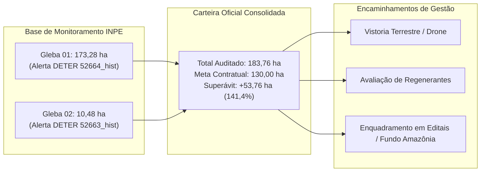

# RELATÓRIO TÉCNICO GEOESPACIAL

**DIAGNÓSTICO OFICIAL DE COBERTURA VEGETAL E BANCO DE ÁREAS ELEGÍVEIS PARA RESTAURAÇÃO FLORESTAL NO PARQUE ESTADUAL CHARAPUCU**

---

### **Identificação Institucional**
* **Órgão Executor:** Instituto de Desenvolvimento Florestal e da Biodiversidade do Estado do Pará (IDEFLOR-Bio)
* **Diretoria:** Diretoria de Gestão da Biodiversidade (DGBIO)
* **Unidade Técnica:** Núcleo de Geotecnologias (NGEO)
* **Unidade de Conservação (UC):** Parque Estadual Charapucu (PES Charapucu)
* **Ato Legal de Criação:** Decreto Estadual nº 2.592, de 09 de novembro de 2010
* **Categoria de Manejo:** Proteção Integral (SNUC / Lei Federal nº 9.985/2000; SEUC / Lei Estadual nº 5.977/1996)
* **Localização Administrativa:** Município de Afuá, Região de Integração do Marajó, Estado do Pará
* **Data do Diagnóstico:** Outubro de 2026
* **Ambiente de Dados:** Sistema de Informações Geográficas do IDEFLOR-Bio / Repositório Oficial NGEO

---

## 1. Sumário Executivo

O presente Relatório Técnico consolida o **diagnóstico geoespacial auditado das áreas abertas por corte raso no interior do Parque Estadual Charapucu**, estruturando um banco qualificado de dados territoriais para subsidiar as tomadas de decisão da **Diretoria de Gestão da Biodiversidade (DGBIO)** e da **Gerência do PES Charapucu**, bem como instrumentalizar a captação de recursos em fundos climáticos e editais de restauração ecológica (ex.: Fundo Amazônia, BNDES, GEF e compensações ambientais).

A investigação espacial utilizou como esteio primário a série histórica oficial do **Sistema de Detecção do Desmatamento em Tempo Real (DETER)**, operado pelo **Instituto Nacional de Pesquisas Espaciais (INPE / TerraBrasilis)**. A auditoria espacial confirmou a existência de **duas glebas contíguas** no setor centro-leste da Unidade de Conservação (adstrito à bacia de drenagem da Baía de Vieira Grande), totalizando **183,76 hectares** de corte raso histórico registrado em 20/07/2019.

| Métrica / Parâmetro | Valor Auditado | Observação Institucional |
| :--- | :---: | :--- |
| **Meta Básica do Projeto** | $130{,}00\text{ ha}$ | Parâmetro referencial inicial |
| **Área Total Mapeada e Auditada** | **$183{,}76\text{ ha}$** | Homologada em bases oficiais DETER/INPE |
| **Desempenho em Relação à Meta** | **$141{,}35\%$** | Meta superada com ampla folga amostral |
| **Superávit Físico Disponível** | **$+53{,}76\text{ ha}$** | Musculatura para seleção de áreas de intervenção |
| **Número de Polígonos Oficiais** | **2 glebas** | Concentração geográfica contígua |
| **Classe Primária no INPE** | `DESMATAMENTO_CR` | Corte Raso Oficial |
| **Data do Evento no INPE** | `20/07/2019` | Sucessão secundária em curso há mais de 6 anos |

---

## 2. Caracterização Geográfica e Legal da Unidade de Conservação

### 2.1 Enquadramento Jurídico
O **Parque Estadual Charapucu** foi criado pelo Decreto Estadual nº 2.592, de 09 de novembro de 2010, abrangendo uma ilha estuarina sob influência do Rio Amazonas e do Oceano Atlântico no Município de Afuá (Arquipélago do Marajó). Trata-se de uma Unidade de Conservação de **Proteção Integral**, cuja finalidade precípua é a preservação de ecossistemas naturais de grande relevância ecológica e beleza cênica, sendo admitido apenas o uso indireto dos seus recursos naturais.

### 2.2 Peculiaridades Ambientais do Bioma Várzea Estuarina
O ecossistema do PES Charapucu é caracterizado predominantemente por **Florestas de Várzea Estuarina de Maré**, com solos hidromórficos de alta deposição sedimentar e regime hídrico semidiurno de marés oceânicas/fluviais. 
* A dinâmica de clareiras nessa região difere substancialmente das florestas de terra firme do sul/sudeste do Pará: a resiliência vegetal e o vigor da regeneração natural são extremamente rápidos, induzidos pelo aporte constante de nutrientes e umidade.
* Seis anos após o corte raso de 2019, o polígono auditado apresenta cobertura florestal em estágio de regeneração secundária (capoeira alta/média dominada por pioneiras como embaúbas (*Cecropia spp.*), ingás (*Inga spp.*), anani (*Symphonia globulifera*) e palmeiras de açaí (*Euterpe oleracea*)), evidenciando o fechamento do dossel nas imagens de satélite recentes (Sentinel-2 2025/2026).

---

## 3. Metodologia de Auditoria Geoespacial e Parâmetros Geodésicos

### 3.1 Parâmetros Geodésicos e Cartográficos
Em rigorosa conformidade com o Sistema Cartográfico Nacional e os padrões do NGEO/IDEFLOR-Bio:
* **Datum Geodésico:** SIRGAS 2000 (*Sistema de Referência Geocêntrico para as Américas*).
* **Projeção de Cálculo Métrico:** `SIRGAS 2000 / UTM zone 22N` (`EPSG:31988`). Todas as áreas planimétricas ($ha$), perímetros e distâncias logísticas foram obrigatoriamente calculadas sob essa projeção plana.
* **Sistema Geográfico de Armazenamento:** `SIRGAS 2000` (`EPSG:4674`).
* **Visualização Web / Mosaicos Leaflet:** `WGS 84` (`EPSG:4326`).

### 3.2 Motivação da Adoção das Bases Oficiais do DETER / INPE
Durante as fases preliminares deste levantamento, identificou-se que modelos espectrais puramente automáticos baseados em limiares instantâneos de NDVI ou NDWI eram induzidos ao erro na várzea do Marajó, interpretando bancos de lama expostos na maré baixa, praias de sedimentos e canais de igarapés como se fossem áreas desmatadas em solo firme.

A integração direta da base oficial do **DETER / INPE (TerraBrasilis)** resolveu esse gargalo com segurança técnica absoluta:
1. **Segurança Jurídica Institucional:** As feições são validadas por especialistas de sensoriamento remoto do INPE, eliminando o risco de contestação judicial ou apontamento indevido por órgãos de fiscalização externa.
2. **Exclusão de Falsos Positivos Hídricos:** Os limites do DETER circunscrevem exclusivamente a área terrestre antropizada, sem inclusão acidental de cursos d'água.
3. **Consistência Histórica:** O evento de 2019 explica tecnicamente por que a área não exibia solo nu recente, mas sim um dossel em fase de reconstituição biológica que demanda atenção silvicultural e de proteção.

---

## 4. Diagnóstico Analítico das Glebas Auditadas

O inventário oficial é composto por dois polígonos contíguos situados a aproximadamente 2,3 a 3,2 km da orla da Baía de Vieira Grande:

| Identificador NGEO | GID Oficial INPE | Data de Detecção | Área Planimétrica ($ha$) | Coordenadas Centróide (Lat / Lon) | Distância à Calha Navegável | Diagnóstico Atual |
| :--- | :---: | :---: | :---: | :---: | :---: | :--- |
| **GLEBA-DETER-01** | `52664_hist` | 20/07/2019 | **$173{,}28\text{ ha}$** | $-0{,}39602^\circ$ / $-50{,}39459^\circ$ | $2.298\text{ m}$ (Baía Vieira Grande) | Corte Raso / Regeneração Secundária |
| **GLEBA-DETER-02** | `52663_hist` | 20/07/2019 | **$10{,}48\text{ ha}$** | $-0{,}38486^\circ$ / $-50{,}40265^\circ$ | $3.214\text{ m}$ (Baía Vieira Grande) | Corte Raso / Regeneração Secundária |
| **TOTAL CONSOLIDADO** | — | — | **$183{,}76\text{ ha}$** | — | — | **Superávit de $+53{,}76\text{ ha}$** |



---

## 5. Análise Logística e Acessibilidade Operacional

* **Setor Hidrográfico:** Setor Leste do PES Charapucu, voltado para a Baía de Vieira Grande.
* **Distância à Margem Fluvial:** As glebas estão localizadas no interior da ilha, a distâncias de $2{,}3\text{ km}$ e $3{,}2\text{ km}$ da orla principal.
* **Aspectos Operacionais para Campo:**
  1. O acesso hidroviário deve ser realizado por embarcações de médio/pequeno porte (voadeiras ou botes de alumínio) partindo da sede municipal de Afuá, navegando pelos furos e igarapés até a boca de acesso na Baía de Vieira Grande.
  2. O planejamento de campo e desembarque de equipes deve ser obrigatoriamente condicionado à **tábua de marés da Capitania dos Portos (Porto de Afuá / Ilha do Marajó)**, aproveitando os picos de maré cheia (*preamar*) para penetração nos igarapés vicinais e evitando o encalhe em baixios de vaza.
  3. A transposição final até o interior das glebas requer abertura de picadas ou uso de drones (VANTs) com sensores multiespectrais/RGB para inspeção prévia de segurança.

---

## 6. Diretrizes Institucionais para a Gestão da Unidade

Em estrito alinhamento com a governança da Diretoria de Gestão da Biodiversidade (DGBIO):
1. **Autonomia da Gestão do Parque:** O presente diagnóstico geotecnológico **não impõe método silvicultural fechado**. A determinação final das ações (se condução de regeneração natural assistida - RNA, adensamento com enriquecimento de espécies nobres de várzea, plantio direto em clareiras remanescentes, ou exclusivamente proteção passiva com vigilância e monitoramento de fauna) caberá à Gestão do Parque Estadual Charapucu após vistoria in situ e escuta das populações tradicionais ribeirinhas circunvizinhas.
2. **Priorização em Editais:** A área consolidada de $183{,}76\text{ ha}$ confere ao IDEFLOR-Bio um ativo espacial pronto e formalmente documentado, permitindo a inscrição de propostas robustas no BNDES/Fundo Amazônia ou na composição de blocos de concessão/restauração ecológica no Estado.

---

## 7. Prancha Cartográfica Oficial Padronizada

Foi gerada a prancha cartográfica institucional no formato **A4 Paisagem ($297 \times 210\text{ mm}$)**, rigorosamente aderente à identidade visual do NGEO e às convenções cartográficas do QGIS:

* **Mapa Principal (Zoom Operacional):** Enquadramento 100% preenchido pela imagem de satélite de alta resolução (Sentinel-2 Cloudless EOX, $10\text{ m}$), delimitando os $183{,}76\text{ ha}$ em destaque contrastante (preenchimento avermelhado translúcido com bordo amarelo-ouro) e rótulos minimalistas dotados de halo escuro e apontador direcional para a feição menor.
* **Mapa Intermediário (Enquadramento na UC):** Contexto completo da ilha do PES Charapucu ($98 \times 70\text{ mm}$), evidenciando a localização exata da ocorrência na porção leste.
* **Mapa Macro (Contextualização Regional):** Limites geopolíticos do Estado do Pará ($98 \times 70\text{ mm}$), estados limítrofes (AP, AM, MT, TO, MA, RR), fronteiras internacionais (Suriname e Guiana Francesa) e o Oceano Atlântico.
* **Acabamento Técnico:**
  - Grade de coordenadas geográficas (*ticks* e *labels*) com snap travado em valores decimais cheios e supressão inteligente de cantos para evitar sobreposições.
  - Textos de latitude no eixo Y orientados a $90^\circ$ vertical ascendente.
  - Seta norte e barra de escala gráfica centralizadas.
  - Legenda limpa e fidedigna, restrita exclusivamente aos vetores carregados (Alerta Auditado, Limite da UC e Limite Estadual), sem falsas camadas hídricas e sem conflito de áreas legais.
  - Logomarcas oficiais do Governo do Estado do Pará, IDEFLOR-Bio e NGEO devidamente inseridas.

> **Arquivos Cartográficos Gerados:**
> * Imagem de Alta Resolução (300 DPI): `outputs/mapas/mapa_layout_qgis_deter_charapucu.png`
> * Prancha Vetorial para Impressão: `outputs/mapas/mapa_layout_qgis_deter_charapucu.pdf`

---

## 8. Repositório de Entregáveis Digitais

Todos os dados técnicos gerados neste trabalho encontram-se organizados e auditáveis na estrutura de diretórios do projeto:

```text
outputs/
├── mapas/
│   ├── mapa_layout_qgis_deter_charapucu.png    # Prancha A4 Paisagem oficial (300 DPI)
│   └── mapa_layout_qgis_deter_charapucu.pdf    # Prancha A4 Paisagem oficial (PDF vetorial)
├── relatorios/
│   ├── relatorio_tecnico_diagnostico_restauracao_pes_charapucu.md # Este documento
│   ├── resumo_executivo_carteira.json          # Metadados estruturados da carteira
│   └── tabela_geral_todas_glebas.csv           # Tabela cadastral detalhada das glebas
├── vetores/
│   ├── banco_restauracao_pes_charapucu.gpkg    # GeoPackage multicamadas (SIRGAS 2000 UTM 22N)
│   └── banco_restauracao_pes_charapucu.geojson # Camada GeoJSON para visualizadores web
└── mapa_deter_charapucu.html                   # Mapa interativo em tela cheia (Leaflet)
```

---

## 9. Conclusão e Próximos Passos Recomendados

1. **Formalização no SEI / IDEFLOR-Bio:** Encaminhar este relatório à Diretoria de Gestão da Biodiversidade (DGBIO) para conhecimento e arquivamento formal no processo de gestão do PES Charapucu.
2. **Planejamento de Vistoria de Campo:** Articular com a equipe do PES Charapucu a inclusão do polígono de $183{,}76\text{ ha}$ no cronograma de rondas fluviais e sobrevoo por drone do próximo trimestre.
3. **Disponibilização no Geoportal:** Integrar o GeoPackage consolidado à base corporativa de dados espaciais do NGEO/IDEFLOR-Bio.

---
*Núcleo de Geotecnologias (NGEO) — IDEFLOR-Bio*  
*Belém — Pará, 2026.*
